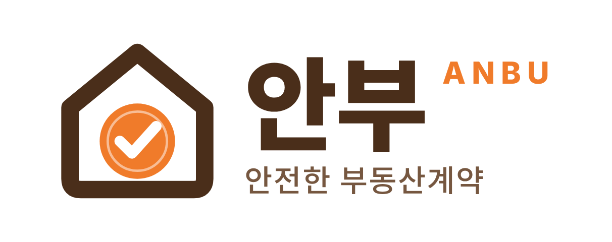
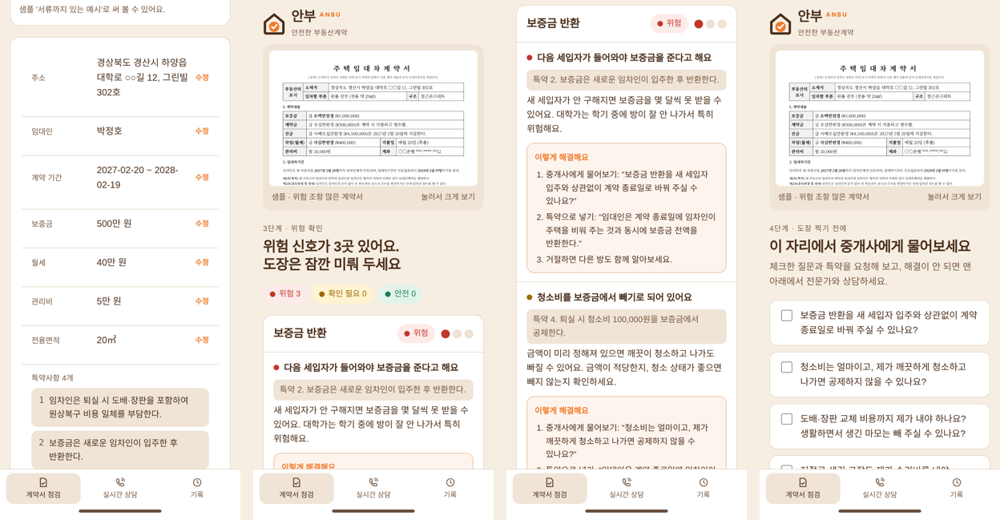
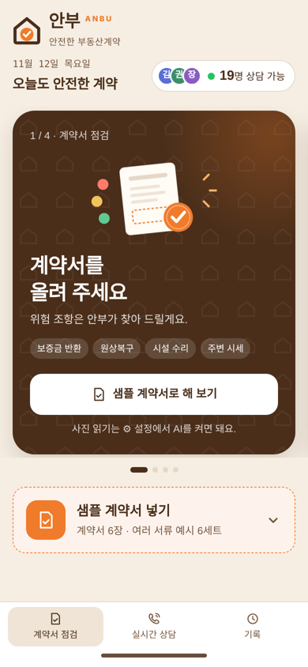
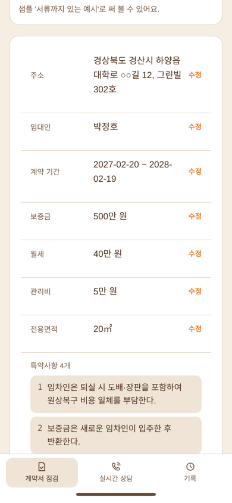
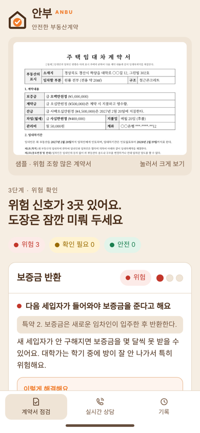
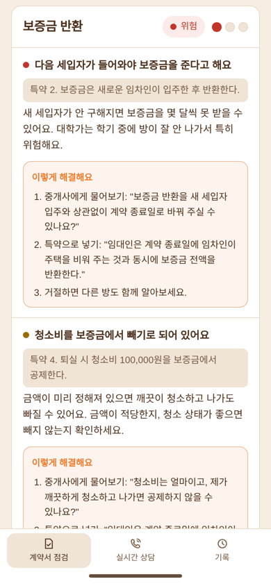
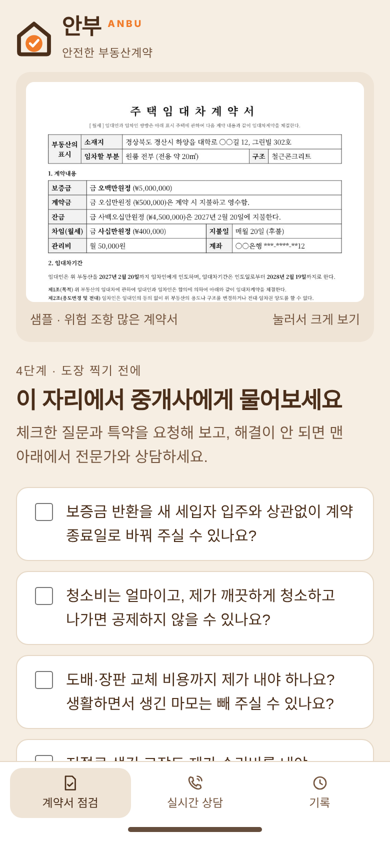
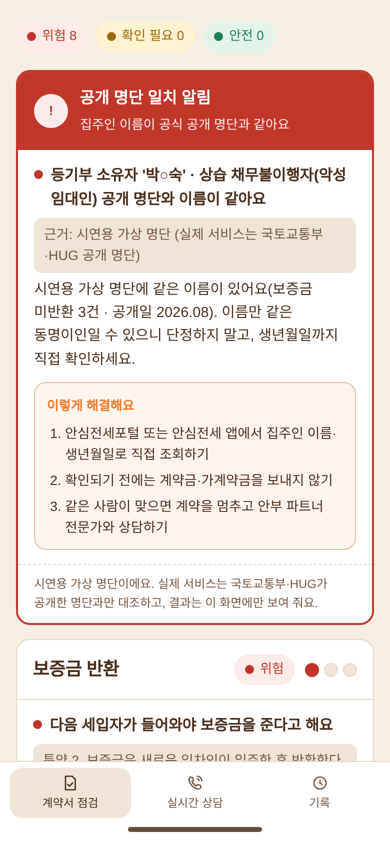

<p align="center">
  
</p>

<h3 align="center">도장 찍기 전, 계약서의 안부를 묻다</h3>

<p align="center">
처음 원룸을 계약하는 대학생이 <b>계약서 사진 한 장</b>으로<br>
1년 뒤 보증금을 지키는 앱
</p>

<p align="center">
2026 빌드 투게더 AI 해커톤 · 팀 <b>5가이즈</b>
</p>

---

## 바로 보기

| | 링크 |
|---|---|
| 앱 (배포 주소) | `당일 배포 후 주소 입력` |
| 발표 랜딩 | `당일 배포 후 주소 입력` |
| 이 저장소에서 바로 열기 | [`app/index.html`](app/index.html) · [`landing/index.html`](landing/index.html) |

> 두 파일 모두 서버 없이 브라우저에서 바로 열려요. GitHub Pages를 켜면 `/app/`과 `/landing/` 주소로 공개할 수 있어요.

<p align="center">
  
</p>

## 1. 문제

매 학기 개강 전 많은 대학생이 자취방을 계약하지만, 대부분 중개사 설명만 듣고 계약서를 제대로 확인하지 못한 채 도장을 찍습니다. 대학가 원룸 보증금은 수백만 원에서 수천만 원인데, 퇴실할 때 원상복구 비용으로 깎이거나 반환이 미뤄지면 학생은 내용증명, 임차권등기, 소송으로 몇 달을 씁니다.

**관찰한 장면**
1. "지금 안 하면 방 금방 나가요" 재촉에 '특약사항', '선순위 보증금'을 이해하지 못한 채 도장을 찍는다.
2. 등기부등본을 떼어도 '근저당', '가압류'를 읽지 못해 커뮤니티에 사진을 올리고 답을 기다린다.
3. 원상복구 범위가 계약서에 없어 벽지 변색 같은 일상적인 마모까지 보증금에서 빠진다.

## 2. 고객

경산 대학가에서 **처음으로 혼자 원룸을 계약하는** 20대 초반 대학생과 사회초년생.

지금은 부모님·선배에게 묻거나, 커뮤니티에 올리거나, 블로그 체크리스트를 찾아봅니다. 하지만 누구도 **내 계약서**를 직접 보지 못하고 답은 늦고 일반적이라, 계약 현장에서는 결국 중개사 설명만 믿게 됩니다.

## 3. 해결

> 도장 찍기 직전 계약서 사진을 찍으면, 보증금 반환·원상복구·시설 수리 조항의 위험을 **빨강·노랑·초록**으로 알려 주고, 그 자리에서 요청할 **질문과 특약**까지 만들어 줍니다.

| | 기존 방법·서비스 | 안부 |
|---|---|---|
| 대상 | 수도권·전세사기 중심 | **지방 대학가 월세 원룸**의 퇴실 분쟁 |
| 방식 | 누구에게나 같은 체크리스트 | AI가 **내 계약서**를 직접 읽음 |
| 시점 | 계약 뒤에 알게 됨 | 도장 찍기 **전**, 현장에서 바로 |

**왜 AI인가**: 계약서마다 문구와 빠진 조항이 달라 고정된 체크리스트로는 못 잡습니다. AI가 사진 속 계약서를 읽고 판정 기준과 대조해, 그 학생의 계약서에 맞는 조언을 바로 만듭니다.

## 4. 핵심 기능

| 단계 | 기능 | 화면 |
|---|---|---|
| ① 찍기 | 계약서 사진을 올리면 AI가 주소·임대인·기간·보증금·월세·특약을 읽음. 틀린 곳은 눌러서 수정 | `app-2-read.png` |
| ② 확인 | 보증금 반환·원상복구·시설 수리 3영역을 빨강·노랑·초록으로 판정, 쉬운 말 설명 | `app-3-result.png` |
| ③ 해결 | 조항마다 "이렇게 해결해요": 물어볼 말, 넣어 달라고 할 특약 | `app-4-fix.png` |
| ④ 요청 | 중개사에게 물어볼 질문 체크리스트, 추천 특약 복사, 그래도 안 되면 전문가 상담 | `app-5-ask.png` |
| + 서류 대조 | 등기부등본·건축물대장·확정일자 부여현황을 함께 올리면 소유자 불일치, 깡통 위험, 위반건축물, 이중계약, 공개 명단 일치를 확인 | `app-6-alert.png` |
| + 시세 비교 | 경산 월세 실거래 기준으로 보증금·월세가 주변보다 높은지 표시 | |

회원가입은 없습니다. 샘플 계약서 6건과 서류 세트 6건이 들어 있어 사진 없이도 모든 기능을 시연할 수 있어요.

<details>
<summary>화면 더 보기</summary>

| 홈 | 읽은 내용 | 위험 판정 |
|---|---|---|
|  |  |  |
| **해결 방법** | **중개사 질문** | **서류 대조 알림** |
|  |  |  |

</details>

## 5. 판정 방식

AI는 **사진을 글로 읽는 일**만 하고, 위험 판정은 법 조문을 근거로 팀이 정한 **규칙**으로 합니다. 그래서 같은 계약서는 항상 같은 결과가 나오고, 근거를 설명할 수 있어요.

| 기준 | 파일 | 내용 |
|---|---|---|
| 위험 조항 | [`data/rules.csv`](data/rules.csv) | 규칙 16개: 분류, 판정, 찾는 표현, 쉬운 설명, 중개사 질문 |
| 추천 특약 | [`data/clauses.csv`](data/clauses.csv) | 특약 문장 4개와 법 근거 |
| 서류 대조 | [`data/doc-checks.csv`](data/doc-checks.csv) | 전세사기·이중계약 판정 기준 12개 (빚+보증금 70% 주의, 80% 위험 등) |
| 주변 시세 | [`data/market-summary.csv`](data/market-summary.csv) | 경산 4개 권역 × 원룸/투룸 보증금·월세 분위 |

같은 내용을 시트별로 정리한 엑셀은 [`data/anbu-data.xlsx`](data/anbu-data.xlsx)에 있어요.

**법 근거**: 주택임대차보호법 제4조 제2항, 민법 제615조·제623조·제654조

## 6. 수익 구조

**학생은 끝까지 무료**이고, 수익은 파트너와 학교에서 나옵니다.

| 누가 | 내는 돈 | 받는 쪽 |
|---|---|---|
| 대학생 | 계약서 점검·서류 대조 **0원** | 없음 |
| 대학생 (원할 때만) | 상담료 | 변호사·중개사에게 **100% 직접** |
| 변호사·중개사 (안부 파트너) | **월 정액 파트너비** | 안부 |
| 대학·생활관·지자체 | **연간 이용료** | 안부 |

안부는 상담 건당 수수료를 받지 않는 **광고형 구조**입니다(변호사법 제34조, 로톡 사례 참고). 전문가 노출 순서는 무작위·접속 중 순입니다. 자세한 내용은 [`docs/revenue-model.md`](docs/revenue-model.md)를 보세요.

## 7. 다음 단계

1. **해커톤 다음 학기**: 하양 대학가에서 무료 점검으로 사용자 모으기, 파트너 시범 상담
2. **12~2월 계약 시즌**: 파트너비 유료 전환, 생활관·학생처 제휴 1곳
3. **1년 차**: 경산 전체로 확대, 입·퇴실 방 사진 기록, 등기부 자동 열람, 지자체 사업
4. **그다음**: 다른 대학가로 표준 특약 확대, 보험대리점 등록 후 전세보증보험 연결

## 실행 방법

설치할 것은 없습니다.

```bash
git clone <이 저장소 주소>
# 앱
open app/index.html          # Windows: start app\index.html
# 발표 랜딩
open landing/index.html
```

- **사진 읽기(AI)**: 앱 오른쪽 위 ⚙ 설정에 OpenAI API 키를 넣으면 계약서·서류 사진을 읽어요. 키는 그 브라우저에만 저장되고 OpenAI에만 전송돼요. **키를 저장소에 올리지 마세요.**
- **키 없이**: 홈의 「샘플 계약서 넣기」로 샘플 6건과 서류 세트 6건을 바로 점검할 수 있어요.
- **발표 모드**: 랜딩에서 `P` 키 또는 오른쪽 아래 버튼. `→`/스페이스로 넘기고, 4분 타이머가 돌아가요. 제2조 화면에서 스페이스를 한 번 더 누르면 제3조가 나와요.
- **휴대폰**: 앱을 휴대폰 브라우저로 열고 「홈 화면에 추가」하면 앱처럼 실행돼요.

## 폴더 구조

```
anbu/
├── app/index.html            # 안부 앱 (단일 파일, 샘플 이미지 내장)
├── landing/index.html        # 발표 랜딩 (제1조~제8조, 발표 모드)
├── data/
│   ├── anbu-data.xlsx        # 당일 개발용 데이터 묶음 (8개 시트)
│   ├── rules.csv             # 위험 조항 기준표
│   ├── clauses.csv           # 추천 특약
│   ├── doc-checks.csv        # 서류 대조 기준
│   ├── market-summary.csv    # 경산 월세 시세 요약
│   ├── market.json           # 앱이 쓰는 시세 분위 데이터
│   └── samples/              # 가상 계약서 6건(c1~c6), 서류 세트 6건(d1~d6)
├── docs/
│   ├── revenue-model.md      # 수익 구조
│   ├── presentation.md       # 4분 발표 구성
│   └── screenshots/          # 앱·랜딩 화면
└── assets/                   # 로고, 앱 아이콘
```

## 데이터 출처와 개인정보

| 데이터 | 출처 |
|---|---|
| 경산 월세 시세 | 국토교통부 실거래가 공개시스템([rt.molit.go.kr](https://rt.molit.go.kr)), 경상북도 경산시 단독·다가구 월세, 2025.11~2026.11 계약 2,825건을 권역·유형별로 요약 |
| 법 조문 | 국가법령정보센터([law.go.kr](https://www.law.go.kr)) |
| 서류 대조 기준 | 국토교통부·HUG 전세사기 예방 안내([안심전세포털](https://www.khug.or.kr))를 참고해 팀이 정한 기준 |

- 샘플 계약서·서류의 **이름, 주소, 금액은 모두 가상**입니다. 전화번호는 가렸고 주민번호는 없습니다.
- 「공개 명단」은 시연용 **가상 명단**이며, 화면에서도 이름을 가려서(박○숙) 보여 줍니다. 실제 서비스에서는 국토교통부·HUG 공개 명단과 대조합니다.
- 실시간 상담 화면의 전문가는 **가상 인물**이고 실제 전화는 연결되지 않습니다.
- 샘플 이미지는 팀이 직접 만든 가상 서류입니다.

## AI 협업

이 프로젝트는 AI와 함께 만들었습니다.

| 영역 | AI가 한 일 | 팀이 한 일 |
|---|---|---|
| 기획 | 문장 다듬기, 발표 구성 제안 | 문제 정의, 고객, 관찰 장면, 차별점 (D1~D4) |
| 판정 기준 | 규칙을 코드로 옮기기 | 위험 조항·특약 문장, 법 근거, 70%·80% 기준 결정 |
| 앱 | 화면과 코드 작성, 샘플 계약서·서류 이미지 생성 | 기능 범위, 화면 흐름, 문구 결정, 테스트 |
| 데이터 | 실거래 자료 요약 | 원본 자료 수집, 권역 구분 |
| 디자인 | 로고·색상 시안 생성 | 최종 로고(크라프트 브라운 #4A2E1A + 오렌지 #F07B2A) 선택 |

## 팀 5가이즈

| 이름 | 역할 |
|---|---|
| 유승빈 | 기획 |
| 팀원 | 역할 |
| 팀원 | 역할 |
| 팀원 | 역할 |
| 팀원 | 역할 |

---

> 안부는 법률 자문이 아닌 참고 정보를 제공합니다. 실제 계약 전에는 공인중개사·변호사 등 전문가와 확인하세요.
