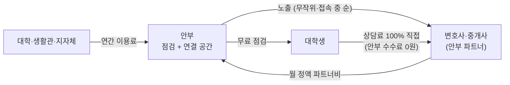

# 안부 수익 구조

> 해커톤 발표용 정리이며 법률 자문이 아닙니다. 실제 사업 전에는 변호사 검토가 필요합니다.

## 한 줄 요약

계약서 점검은 학생에게 끝까지 무료이고, 안부는 실시간 상담에 참여하는 **안부 파트너 전문가의 월 정액 파트너비**와 **대학·지자체 B2B 이용료**로 돈을 법니다. 상담료는 전문가에게 100% 가고, 안부는 상담 건당 수수료를 받지 않습니다.

## 돈의 흐름

## 왜 상담 건당 수수료를 받지 않나

"상담 1건 연결 → 상담료의 일부"를 받는 구조는 **변호사법 제34조**(변호사가 아닌 자의 사건 소개·알선 대가 금지)에 걸릴 수 있습니다.

- **로톡 사례**: 변협은 로톡을 알선 플랫폼이라며 이용 변호사를 징계했지만, 법무부는 2023년 9월 123명의 징계를 사실상 모두 취소했습니다.
- **법무부가 본 근거**: 로톡은 광고비를 받는 "광고 공간"일 뿐이고, 상담 과정에서 수수료를 받지 않았으며, 광고비를 낸 변호사의 노출 순서가 무작위였다는 점입니다.
- **공인중개사도 같은 원칙**: 안부가 중개 보수를 나눠 받으면 무등록 중개 문제가 생길 수 있어, 중개사 파트너도 정액 광고비만 받습니다.

## 수익원

| 순서 | 수익원 | 누가 내나 | 무엇을 주나 | 시점 | 확인할 것 |
|---|---|---|---|---|---|
| ① | 안부 파트너비 (월 정액) | 변호사·공인중개사 | 프로필 노출, "접속 중" 실시간 표시, 상담 버튼 | 출시 직후 | 노출은 무작위·접속 중 순, 상담 수수료 0원 |
| ② | 대학·생활관·총학생회 이용료 (연간) | 대학 학생처·생활관, 학생회 | 신입생·자취생 무료 제공, 학교별 맞춤 안내 | 출시 직후 | 경산 대학가 시범 1곳 |
| ③ | 지자체 청년 주거 사업 | 경산시·경상북도 | 청년 전월세 피해 예방 도구 | 1년 차 | 공모·위탁 사업 일정 |
| ④ | 이사·청소·입주 점검 제휴 광고 | 지역 업체 | 계약 직후 사용자에게 노출 | 1년 차 | 광고 표시 원칙 |
| ⑤ | 전세보증보험 연결 | 보험사 | 보험 가입 연결 | 다음 단계 | 판매 수수료는 보험대리점 등록 필요 |

## 앱에서 지킬 원칙

- 전문가 목록은 **무작위 또는 접속 중 순**으로 보여 주고, 돈을 더 낸 사람을 위로 올리지 않습니다.
- 상담 화면에 **"상담료는 전문가에게 직접 지급돼요. 안부는 수수료를 받지 않아요"**를 적습니다.
- "안부 파트너"는 "안부에 광고하는 전문가"라는 뜻으로만 씁니다. 안부가 사건을 배정하거나 추천하지 않습니다.
- 점검 결과에는 "법률 자문이 아닌 참고 정보" 문구를 넣습니다.

## 예상 질문

| 질문 | 답 |
|---|---|
| 변호사법 위반 아닌가요? | 상담 건당 수수료가 없는 정액 광고형이에요. 로톡 사례에서 법무부가 문제없다고 본 구조예요. |
| 학생이 돈을 안 내면 어떻게 버나요? | 돈을 내는 사람은 학생을 만나고 싶은 전문가와, 학생 피해를 줄이고 싶은 학교·지자체예요. |
| 파트너가 돈을 더 내면 위에 뜨나요? | 아니요. 노출은 무작위·접속 중 순이에요. 학생에게 공정해야 신뢰가 생겨요. |
| 안부가 법률 자문을 하는 건가요? | 안부는 참고 정보를 보여 주고, 법률 판단은 파트너 변호사가 해요. |

## 출처

- [법무부 "로톡은 광고형 플랫폼… 변호사법 위반 아니다" (법률신문)](https://www.lawtimes.co.kr/news/articleViewAmp.html?idxno=172383)
- [전문직 플랫폼 성장통① (이코노미스트, 2023.10)](https://economist.co.kr/article/view/ecn202310240043)
